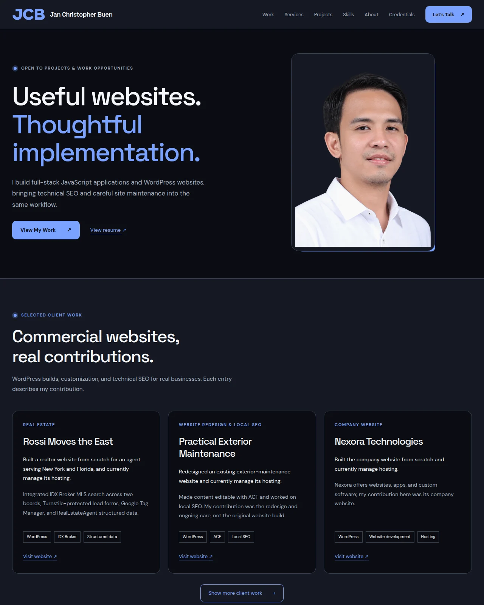

# Jan Christopher Buen — Developer Portfolio

A personal portfolio for clients, hiring managers, developers, and anyone who wants to explore my WordPress client work, technical SEO experience, and personal full-stack JavaScript projects. It introduces what I build, explains a few engineering decisions, and links directly to the projects and their source.

I built this website for [The Odin Project’s personal website assignment](https://www.theodinproject.com/lessons/node-path-getting-hired-building-your-personal-website), to bring my work together in one clear, approachable place. It now also documents my WordPress client contributions.



[Visit the live portfolio](https://janchristopherbuen.vercel.app/)

## What you can explore

- A portrait introduction with direct work and contact links.
- **Commercial client work:** featured cards for Rossi Moves the East, Practical Exterior Maintenance, and Nexora Technologies. A “Show more client work” control reveals matching cards for Ironclad Sites and Paver Sealing Academy. Practical Exterior Maintenance is clearly identified as a redesign of an existing website.
- **Services:** WordPress websites, redesign and maintenance, technical SEO setup, and custom web applications supported by personal-project examples.
- **Personal full-stack projects:** Commonroom, Midnight Market, and Signal Post, with screenshots, features, engineering decisions, and live/source links.
- Skills grouped into frontend, backend/data, WordPress, and tools/deployment.
- Current experience, seven certifications, and separate self-directed learning through The Odin Project and Learn WordPress.
- Neutral dark surfaces with warm orange actions, responsive navigation, visible keyboard focus, a skip link, and motion that respects reduced-motion preferences.

The full-stack applications are personal learning projects, separate from the commercial WordPress work. Their free-hosted APIs may take about a minute to wake; provider limits can affect availability. Follow each source link for setup instructions and limitations.

## Stack

React, Vite, JavaScript, HTML, and plain CSS. ESLint checks the source and Prettier applies single quotes with no semicolons. There is no backend, database, analytics, or contact form for this website.

## Run locally

Use **Node.js 24 LTS** and npm. From the repository directory:

```sh
npm ci
npm run dev
```

Open the local URL printed by Vite. No environment variables or credentials are required.

| Command                | Purpose                                  |
| ---------------------- | ---------------------------------------- |
| `npm run dev`          | Start the development server             |
| `npm run build`        | Create the production website in `dist/` |
| `npm run preview`      | Preview the production build locally     |
| `npm run lint`         | Check JavaScript and React rules         |
| `npm run format`       | Format source and documentation          |
| `npm run format:check` | Check formatting without changing files  |

To preview a release build, run `npm run build` followed by `npm run preview`.

## Structure and customization

```text
src/App.jsx                    Page composition, hero, about, and contact
src/components/                Navigation, client work, services, projects, skills, credentials
src/data/clientWork.js         Commercial contributions and live links
src/data/projects.js           Personal projects and source links
src/data/credentials.js        Credential titles, issuers, available dates and links
src/styles.css                 Theme tokens, layout, responsive rules, and motion
public/images/                 Portrait and real personal-project screenshots
docs/                          Screenshot of the completed portfolio
index.html                     Page title, description, and social metadata
```

Edit the modules in `src/data/` to update client work, personal projects, or credentials. Only add credential dates and verification URLs supported by the certificate or issuer. When replacing a personal-project screenshot in `public/images/`, keep its alternative text and dimensions accurate. Update the introduction, about text, and contact profile in `src/App.jsx`. The GitHub profile URL is centralized in the data module. Color variables and responsive styles live in `src/styles.css`.

The contact section includes my approved email address and verified GitHub profile. No résumé is published. The page uses the confirmed production URL for canonical and Open Graph URL metadata. No social image is configured.

## Assets and references

The portrait was supplied by Jan Christopher Buen for this portfolio. The monogram favicon and visual identity were created for this portfolio. Project images are actual browser captures of my own applications’ public landing/sign-in pages; they do not include private conversations or account data. Midnight Market’s original illustration is covered by [its repository’s MIT license](https://github.com/jan-christopher-buen/odin-wheres-waldo). Screenshots are optimized to WebP.

Typography uses [DM Sans](https://fonts.google.com/specimen/DM+Sans) and [Space Grotesk](https://fonts.google.com/specimen/Space+Grotesk), available under the SIL Open Font License and loaded from Google Fonts with system-font fallbacks. Font delivery requires an internet connection; the page remains usable without it.

The assignment’s [Forbes article](https://www.forbes.com/sites/jacquelynsmith/2013/04/26/why-every-job-seeker-should-have-a-personal-website-and-what-it-should-include/) informed the focus on identity, relevant work, and clear contact links. [Write the Docs](https://www.writethedocs.org/guide/writing/beginners-guide-to-docs/) informed this README’s purpose, setup, and customization guidance.

Design research included [Brittany Chiang](https://brittanychiang.com/) for clear project evidence, [Josh W. Comeau](https://www.joshwcomeau.com/) for readable content hierarchy, and [Adham Dannaway](https://www.adhamdannaway.com/) for direct work/about/contact navigation. This portfolio uses its own layout, copy, and visual identity.

## Hosting

Hosted on Vercel’s free Hobby plan at [janchristopherbuen.vercel.app](https://janchristopherbuen.vercel.app/).

The project uses the repository root, the Vite preset, Node.js **24.x**, install command **`npm ci`**, build command **`npm run build`**, and output directory **`dist`**. No environment variables or SPA routing rewrites are required. The production branch is `main`.

The canonical and Open Graph URLs in `index.html` point to the live portfolio. If the production domain changes, update both metadata URLs and the links in this README. Add a social image only when an actual hosted image is available.

## Feedback

Browse more work on [my GitHub profile](https://github.com/jan-christopher-buen) or [open an issue](https://github.com/jan-christopher-buen/personal-portfolio/issues) with a clear description of a problem or suggestion.
